<p align="center">
  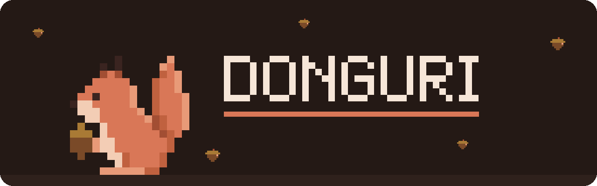
</p>

<p align="center">
  <b>A pixel-art squirrel on the edge of your screen that keeps your context for any AI.</b><br>
  Select, save, ask and paste. Local, light and account-free.
</p>

<p align="center">
  <a href="https://github.com/juanccstro/donguri/releases/latest"></a>
</p>

<p align="center">
  <a href="README.md">Español</a> · Windows 10 / 11 · Free
</p>

<p align="center">
  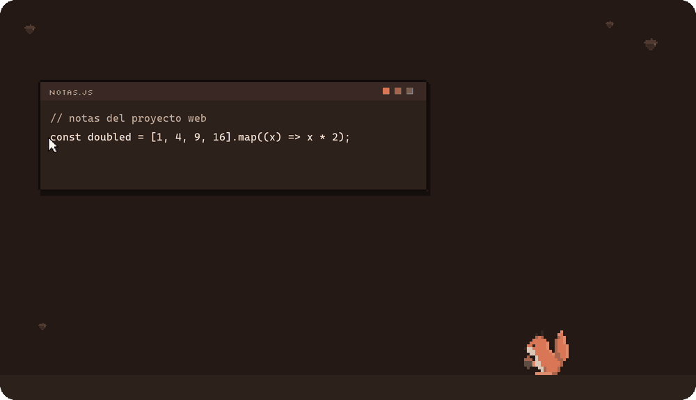
</p>

<p align="center"><sub>The app speaks Spanish and English; the screenshots are in Spanish.</sub></p>

## What it does

| | |
|---|---|
|  **Quick acorn** | Select text in any app and a tiny acorn appears: Ask, Summarize, Translate, Explain or Save. |
|  **Nests** | Save text, screenshots and files by topic. Search them and paste them as context anywhere. Includes an optional clipboard history (memory only). |
|  **Ask** | Answers with your Gemini (free tier), Claude or OpenAI key. It sees your captures: crop an area and ask what it is or what text it holds. With no key, it opens Claude or ChatGPT with your text ready to paste. |
|  **Your nests in Claude** | Connects to Claude Desktop and Claude Code: type “use my Trip nest” and it uses them with your subscription. |
| 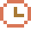 **Pomodoro** | 25/5, 50/10, 90/20 or your own. Her acorn fills while you focus and she naps during breaks. |
|  **Private** | Everything stays on your PC, keys go to the Windows Credential Manager, no telemetry, invisible in recordings. |

## Install

1. Download **`Donguri_x.y.z_x64-setup.exe`** from [Releases](https://github.com/juanccstro/donguri/releases/latest).
2. Open it. If Windows says *“Windows protected your PC”*, click **More info → Run anyway** (the app is not signed yet).
3. Follow the **first setup**: language, how you want her, quick acorn, privacy, AI and whether she starts with Windows.

No admin rights needed; uninstall from *Settings → Apps*.

## How to use it

| Gesture | What happens |
|---|---|
| **Click** the squirrel | Menu: Ask, Nests, Paste nest, Pomodoro and Settings |
| **Right-click** | Save, capture, hide, modes, size and more |
| **Drag her** | Moves her to another edge (any monitor) |
| **Drop** text or files on her | Saves them in a nest |
| **Ctrl+V** with the pointer on her | Gives her what you copied |
| `Alt+Shift+S` · `Alt+Shift+X` | Save selection · Capture an area |
| `Alt+Shift+Space` · `Alt+Shift+B` | Quick question · Show or hide |
| `Alt+Shift+A` · `Alt+Shift+V` | Capture and ask · Clipboard history |

Everything can be changed in **Settings**; repeat the first setup from *Settings → Help*.

## Gallery

<table>
  <tr>
    <td align="center" width="50%">
      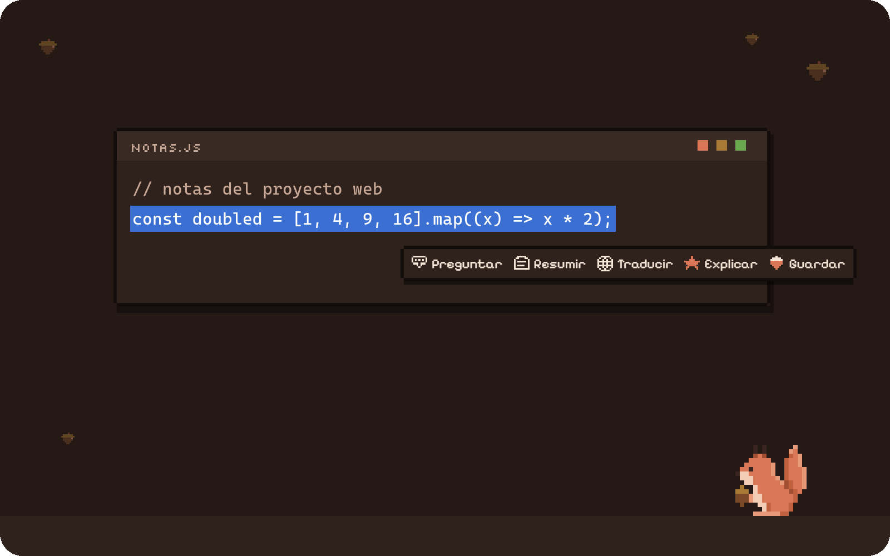<br>
      <b>Quick acorn</b><br>
      <sub>Select text in any app and pick what to do with it</sub>
    </td>
    <td align="center" width="50%">
      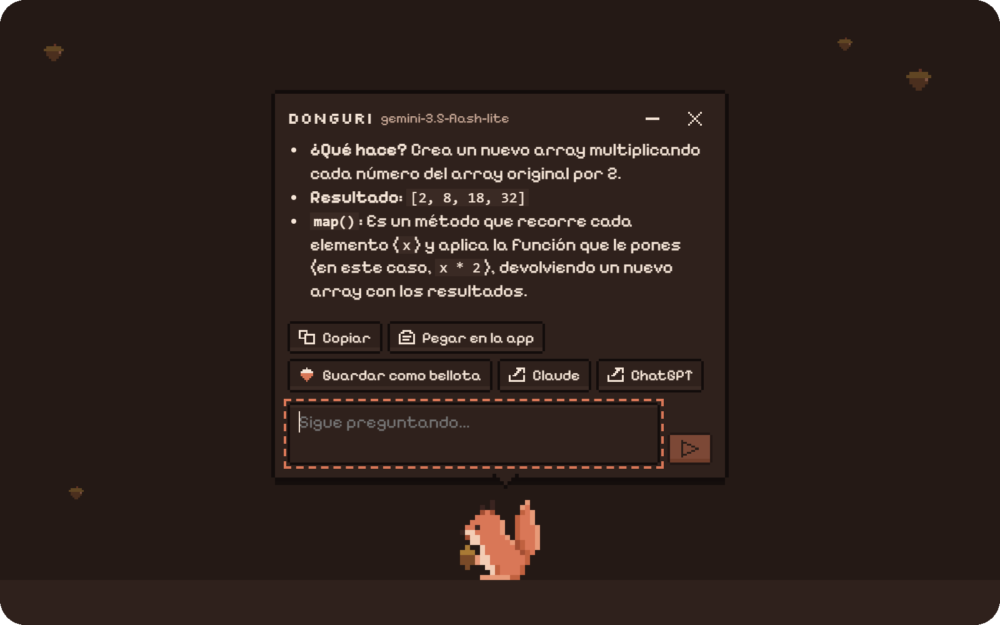<br>
      <b>Instant answers</b><br>
      <sub>Explains, summarizes or translates in a bubble</sub>
    </td>
  </tr>
  <tr>
    <td align="center" width="50%">
      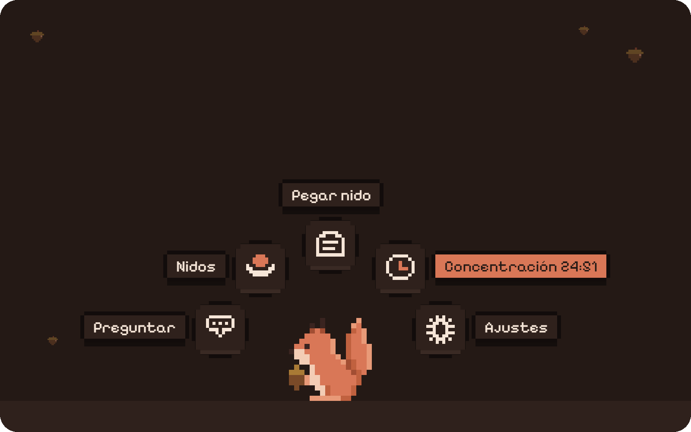<br>
      <b>One click on the squirrel</b><br>
      <sub>Ask, Nests, Paste nest, Pomodoro and Settings</sub>
    </td>
    <td align="center" width="50%">
      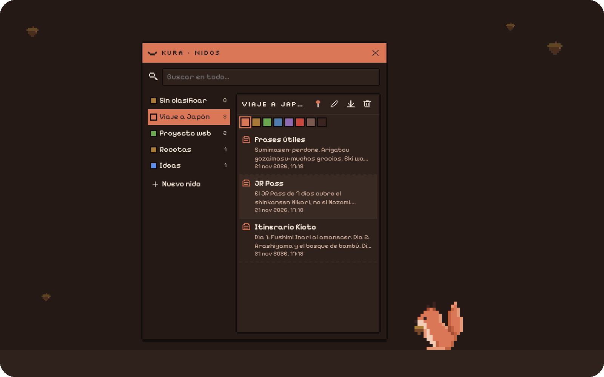<br>
      <b>Nests</b><br>
      <sub>Everything you save, by topic and searchable</sub>
    </td>
  </tr>
  <tr>
    <td align="center" width="50%">
      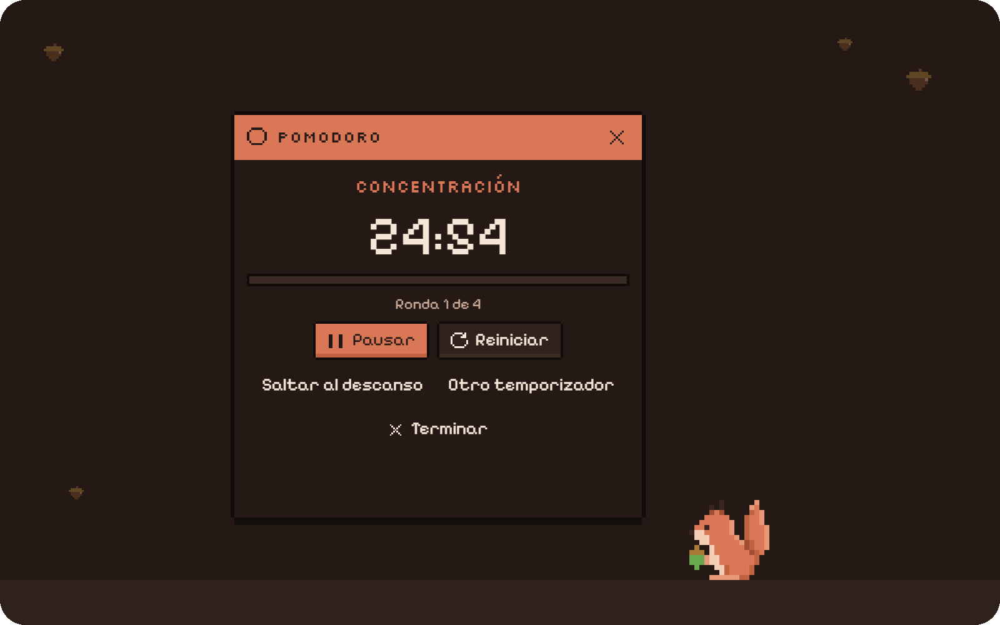<br>
      <b>Pomodoro</b><br>
      <sub>Her acorn fills while you focus</sub>
    </td>
    <td align="center" width="50%">
      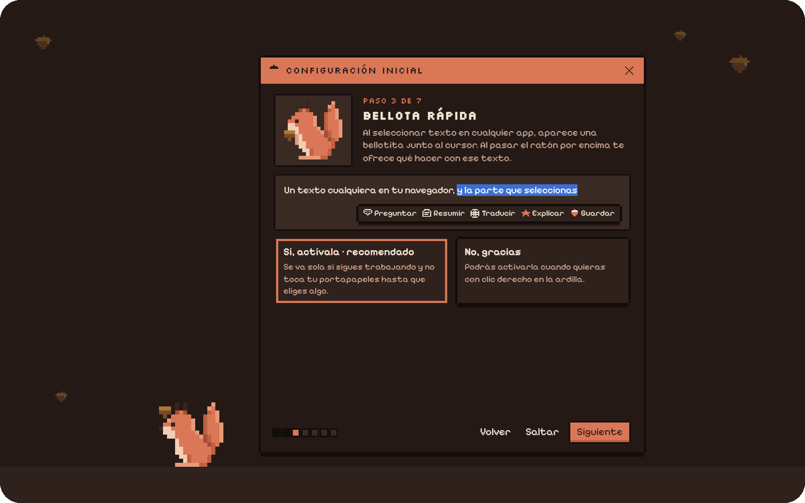<br>
      <b>First setup</b><br>
      <sub>Ready in a minute, no accounts</sub>
    </td>
  </tr>
  <tr>
    <td align="center" width="50%">
      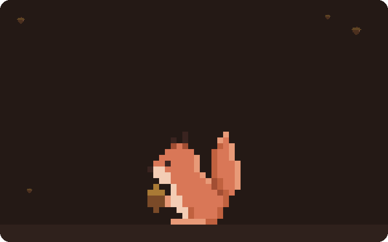<br>
      <b>Lively mode</b><br>
      <sub>She breathes, wags her tail and sometimes drops her acorn</sub>
    </td>
    <td align="center" width="50%">
      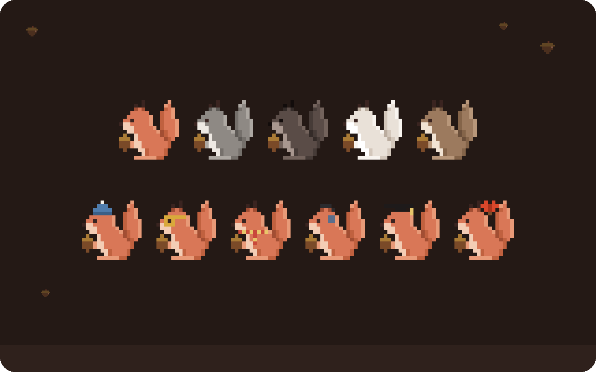<br>
      <b>Your squirrel</b><br>
      <sub>5 colours and 6 accessories</sub>
    </td>
  </tr>
</table>

## Build from source

Needs [Node.js](https://nodejs.org) 22+, [Rust](https://rustup.rs) and the [Tauri prerequisites](https://v2.tauri.app/start/prerequisites/).

```bash
npm install
npm run tauri dev     # development
npm run tauri build   # installer in src-tauri/target/release/bundle/nsis
```

Built with Tauri 2, Rust and Svelte 5.

## License

© 2026 [juanccstro](https://github.com/juanccstro). Source-available, not open source: you may use Donguri and propose changes through pull requests, but not publish, sell or redistribute copies or your own versions. See [LICENSE](LICENSE).
