<p align="center">
  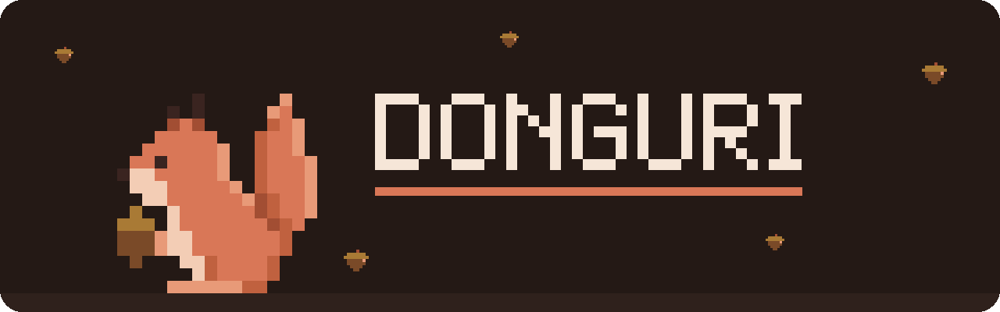
</p>

<p align="center">
  <b>Una ardilla pixel-art en el borde de tu pantalla que guarda tu contexto para cualquier IA.</b><br>
  Selecciona, guarda, pregunta y pega. Local, ligera y sin cuentas.
</p>

<p align="center">
  <a href="https://github.com/juanccstro/donguri/releases/latest"></a>
</p>

<p align="center">
  <a href="README.en.md">English</a> · Windows 10 / 11 · Gratis
</p>

<p align="center">
  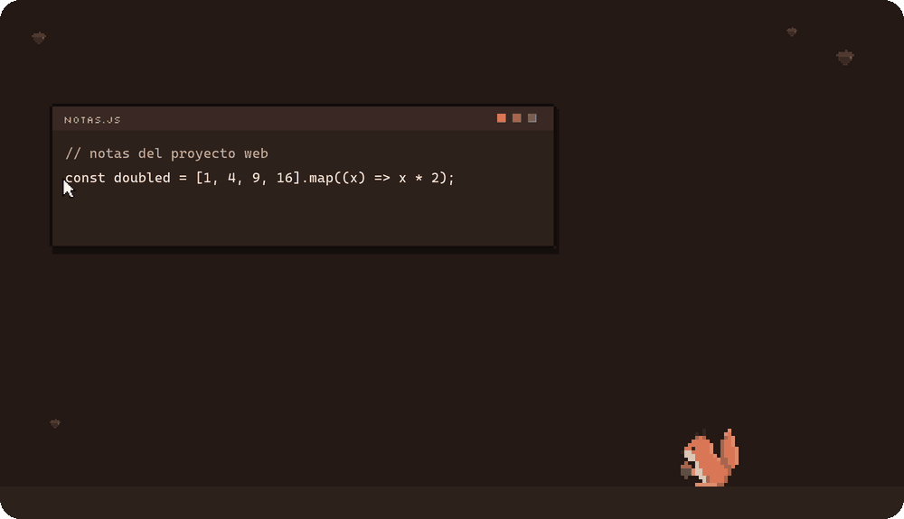
</p>

## Qué hace

| | |
|---|---|
|  **Bellota rápida** | Selecciona texto en cualquier app y aparece una bellotita: Preguntar, Resumir, Traducir, Explicar o Guardar. |
|  **Nidos** | Guarda textos, capturas y archivos por temas. Búscalos y pégalos como contexto donde quieras. |
|  **Pregunta** | Responde con tu clave de Gemini (tiene nivel gratis), Claude u OpenAI. Sin clave, abre Claude o ChatGPT con tu texto listo para pegar. |
|  **Tus nidos en Claude** | Se conecta a Claude Desktop y Claude Code: escribe «usa mi nido Viaje» y los usa con tu suscripción. |
| 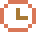 **Pomodoro** | 25/5, 50/10, 90/20 o a tu medida. Su bellota se llena mientras te concentras y duerme en los descansos. |
|  **Privada** | Todo se queda en tu PC, las claves van al Administrador de credenciales de Windows, sin telemetría e invisible en grabaciones. |

## Instalar

1. Descarga **`Donguri_x.y.z_x64-setup.exe`** desde [Releases](https://github.com/juanccstro/donguri/releases/latest).
2. Ábrelo. Si Windows avisa *«Windows protegió tu PC»*, pulsa **Más información → Ejecutar de todas formas** (la app aún no está firmada).
3. Sigue la **configuración inicial**: idioma, cómo la quieres, bellota rápida, privacidad, IA y si arranca con Windows.

No pide permisos de administrador y se desinstala desde *Configuración → Aplicaciones*.

## Cómo se usa

| Gesto | Qué pasa |
|---|---|
| **Clic** en la ardilla | Menú: Preguntar, Nidos, Pegar nido, Pomodoro y Ajustes |
| **Clic derecho** | Guardar, capturar, ocultar, modos, tamaño y más |
| **Arrastrarla** | Cambia de borde (en cualquier monitor) |
| **Soltar** texto o archivos encima | Los guarda en un nido |
| **Ctrl+V** con el ratón encima | Le da lo que tengas copiado |
| `Alt+Shift+S` · `Alt+Shift+X` | Guardar la selección · Capturar una zona |
| `Alt+Shift+Space` · `Alt+Shift+B` | Pregunta rápida · Mostrar u ocultar |

Todo se cambia en **Ajustes**, y la configuración inicial se repite desde *Ajustes → Ayuda*.

## Galería

<table>
  <tr>
    <td align="center" width="50%">
      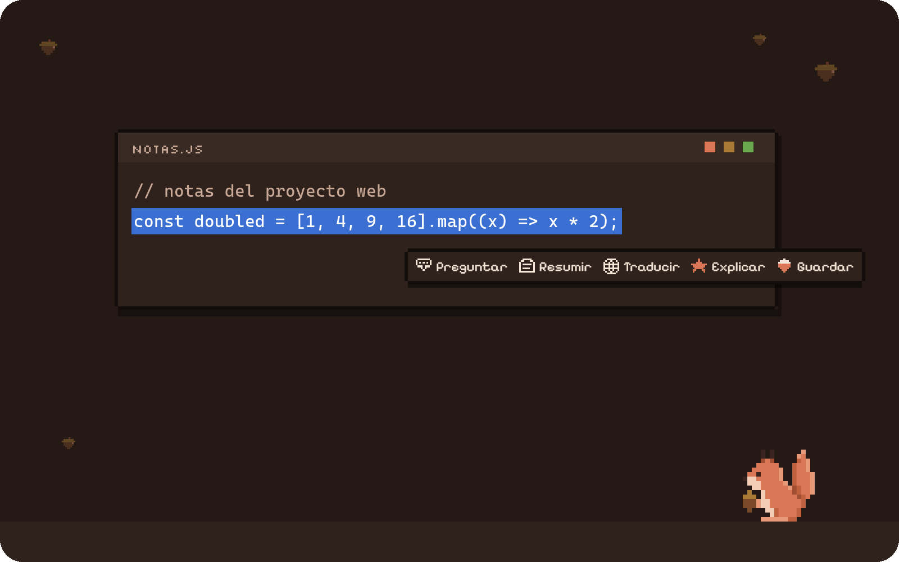<br>
      <b>Bellota rápida</b><br>
      <sub>Selecciona texto en cualquier app y elige qué hacer con él</sub>
    </td>
    <td align="center" width="50%">
      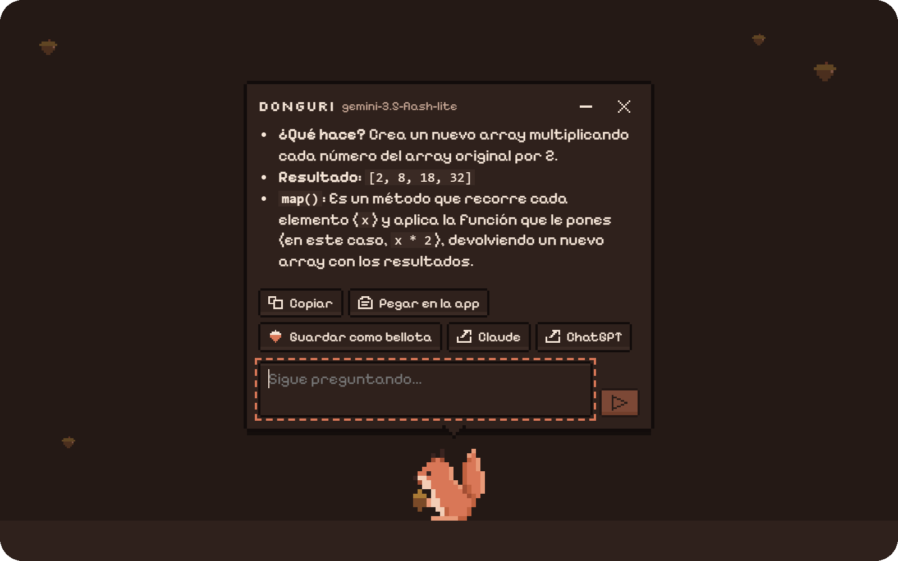<br>
      <b>Respuestas al momento</b><br>
      <sub>Explica, resume o traduce en un bocadillo</sub>
    </td>
  </tr>
  <tr>
    <td align="center" width="50%">
      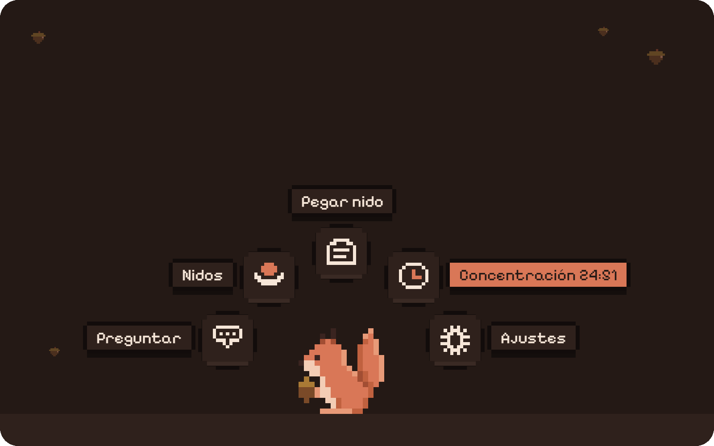<br>
      <b>Un clic en la ardilla</b><br>
      <sub>Preguntar, Nidos, Pegar nido, Pomodoro y Ajustes</sub>
    </td>
    <td align="center" width="50%">
      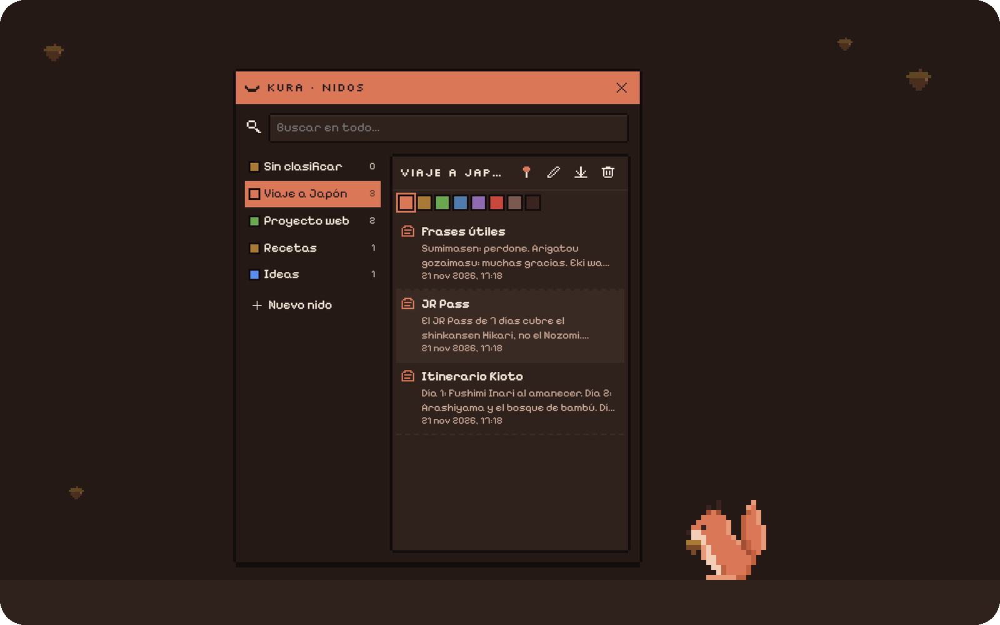<br>
      <b>Nidos</b><br>
      <sub>Todo lo que guardas, por temas y con buscador</sub>
    </td>
  </tr>
  <tr>
    <td align="center" width="50%">
      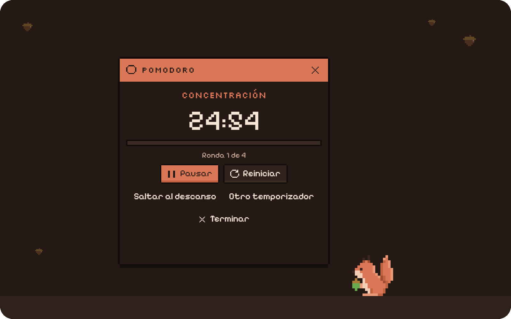<br>
      <b>Pomodoro</b><br>
      <sub>Su bellota se llena mientras te concentras</sub>
    </td>
    <td align="center" width="50%">
      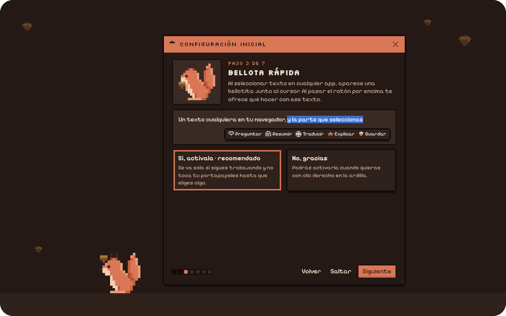<br>
      <b>Configuración inicial</b><br>
      <sub>Lista en un minuto, sin cuentas</sub>
    </td>
  </tr>
  <tr>
    <td align="center" width="50%">
      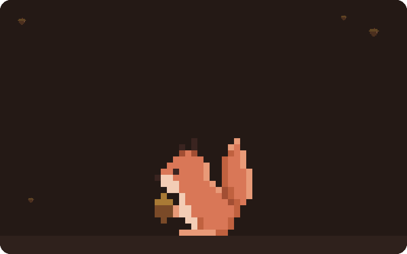<br>
      <b>Modo Viva</b><br>
      <sub>Respira, mueve la cola y a veces se le cae la bellota</sub>
    </td>
    <td align="center" width="50%">
      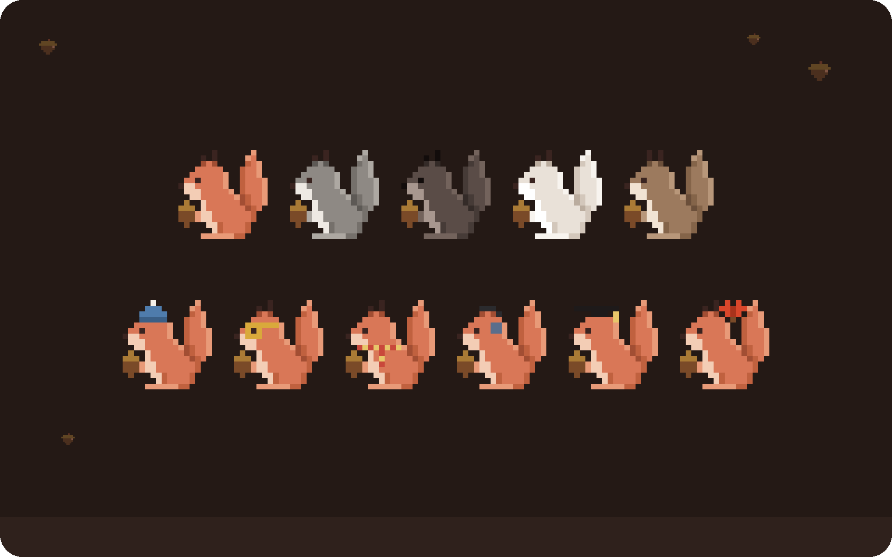<br>
      <b>Tu ardilla</b><br>
      <sub>5 colores y 6 accesorios</sub>
    </td>
  </tr>
</table>

## Compilar desde el código

Requiere [Node.js](https://nodejs.org) 22+, [Rust](https://rustup.rs) y los [requisitos de Tauri](https://v2.tauri.app/start/prerequisites/).

```bash
npm install
npm run tauri dev     # desarrollo
npm run tauri build   # instalador en src-tauri/target/release/bundle/nsis
```

Hecho con Tauri 2, Rust y Svelte 5.

## Licencia

© 2026 [juanccstro](https://github.com/juanccstro). Código visible, no de código abierto: puedes usar Donguri y proponer cambios con *pull requests*, pero no publicar, vender ni redistribuir copias o versiones propias. Detalles en [LICENSE](LICENSE).
